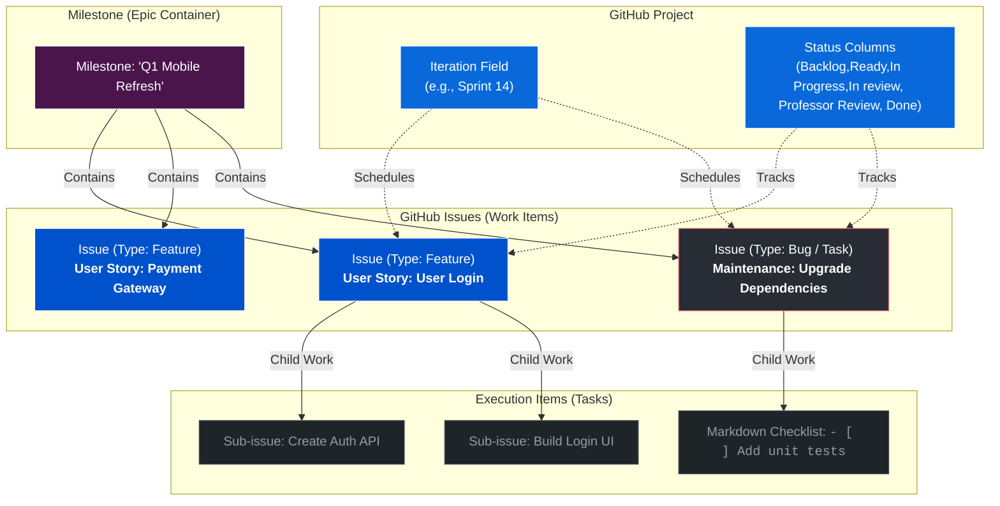

|ADO Concept|Proposed|Built-in GitHub Mechanism|Why It Works Well Here|
|-|-|-|-|
|Epic|Milestone|Repository Milestone|Solves the missing "Epic" type by using Milestones as high-level feature containers.
|Story|Feature|Native Issue Type: Feature|Uses the built-in Feature type to represent deliverable user value.
|Maintenance Task|Task|Native Issue Type: Task with label maintenance|Uses Task for maintenance/tech debt.|
|Bug|Bug|Native Issue Type: Bug|Uses Bug for fixes/issues|
|Task|Issue Sub-item|Native Sub-issue or Markdown [ ]|Actionable steps nested directly inside the parent Feature issue.|

We use Milestones as Epics, GitHub limits each issue to one single Milestone, which I don't see an issue with.

To make this structure work smoothly, keep these two rules in mind:

1. Use Project Iterations for Sprints: Do not use Milestones for Sprints (e.g., "Sprint 12").
  - Use the GitHub Project Iteration Field for time-boxed sprint tracking instead.
  I don't think this is applicable for how this project runs, so it's not much of a concern.
2. Use GitHub Releases for Code Versions:
  - Do not use Milestones for release versions (e.g., v1.2.0). Use GitHub Releases / Tags for software delivery milestones instead.

Example Diagram:
